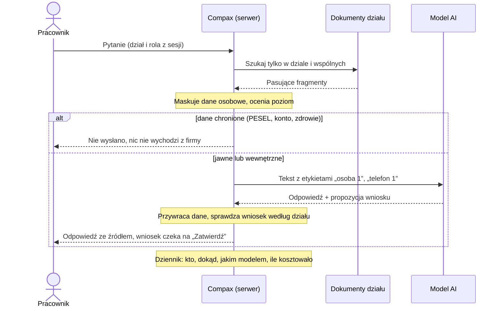

# Compax – jedno AI dla firmy z kilkoma działami

[](https://github.com/PiotrBednarski-EngineerOfHumanGoods/ai-platforma-demo/actions/workflows/ci.yml)

**Demo na żywo:** https://compax.tech · logowanie: https://compax.tech/app (konta pokazowe na ekranie logowania)

> **Pytanie:** firma ma kilka działów i chce dać pracownikom AI, ale działy mają różne dane i uprawnienia, a firma nie ma systemu CRM. Jak to zrobić?

## Jak to rozwiązałem: jedna platforma dla wszystkich działów

Zamiast osobnego AI dla każdego działu jest **jeden asystent i jeden punkt dostępu do AI**, a każdy dział ma w nim własne ustawienia: własne dokumenty, własne narzędzia i własne zasady, z jakich modeli wolno korzystać. Wszyscy logują się w jednym miejscu, ale każdy widzi tylko to, do czego ma prawo.

| Wspólne dla całej firmy | Osobne dla każdego działu |
|---|---|
| logowanie i role | dokumenty (procedury, cenniki, windykacja) |
| brama do modeli AI (Claude, GPT, model w firmie) | narzędzia (np. sprzedaż umawia spotkania, księgowość wysyła przypomnienia o płatności) |
| maskowanie danych osobowych i blokada danych chronionych | dozwolone modele (księgowość i zarząd: tylko model w firmie, bez chmury) |
| dziennik, koszty i budżet dla zarządu | limit pytań do chmury |

Cztery zasady, na których opiera się całość:

1. **Uprawnienia przed wyszukiwaniem.** Asystent szuka tylko w dokumentach działu pracownika i we wspólnych. Model nigdy nie dostaje dokumentu, którego pracownik nie mógłby otworzyć sam.
2. **Dane osobowe nie wychodzą jawnie.** Rozpoznane nazwiska, telefony, e-maile i adresy są zamieniane na etykiety („osoba 1”) przed wysłaniem do modelu (to pseudonimizacja, nie anonimizacja). Pytania z rozpoznanymi danymi chronionymi (PESEL, numer konta, karta, dowód, zdrowie, wynagrodzenia, hasła) nie trafiają do chmury; fragmenty dokumentów z takimi danymi też nie. Wykrywanie działa na regułach: typowe zapisy łapie, celowe obejście jest możliwe (szczegóły i ryzyko resztkowe: [docs/AUDYT-COMPAX.md](docs/AUDYT-COMPAX.md)).
3. **Człowiek decyduje.** Asystent tylko przygotowuje spotkanie, notatkę albo przypomnienie. Nic się nie dzieje bez „Zatwierdź”.
4. **Zarząd widzi wszystko, co trzeba.** Kto pytał, dokąd trafiło pytanie, jakim modelem, ile kosztowało. Bez treści danych osobowych.

**Nowy dział** to folder z dokumentami i kilka wierszy konfiguracji, a nie nowy projekt.

| Dział | Widzi dokumenty | Asystent przygotowuje | Model |
|---|---|---|---|
| Sprzedaż | cennik, rabaty, oferty + wspólne | spotkanie, notatkę o kliencie | Claude, po maskowaniu |
| Obsługa klienta | awarie, statusy, reklamacje | spotkanie, notatkę | Claude, po maskowaniu |
| Biuro | sale, delegacje, zamówienia | spotkanie, notatkę | Claude, po maskowaniu |
| Księgowość | windykacja, korekty, płatności | przypomnienie o płatności | tylko model w firmie |
| Zarząd | wszystko | wszystko + dziennik, koszty, uprawnienia | tylko model w firmie |

## Firma nie ma systemu CRM: sprawy prowadzi asystent

Nie trzeba kupować ani wdrażać systemu CRM, żeby asystent pamiętał klientów. **Każdy zatwierdzony wniosek staje się sprawą**: spotkanie, notatka o kliencie albo przypomnienie o płatności, z klientem, terminem i następnym krokiem.

- **Zakładka Sprawy:** dział widzi swoje sprawy, zarząd wszystkie. Filtrowanie według klienta, rodzaju, działu i daty.
- **Bez przepisywania:** handlowiec pisze „umów spotkanie z firmą X we wtorek”, zatwierdza jednym kliknięciem i sprawa jest zapisana.
- **Bezpiecznie:** sprawy są szyfrowane na dysku, a dane osoby można wyszukać, wyeksportować i usunąć jednym poleceniem (RODO).
- **Na później:** gdy firma wdroży CRM albo kalendarz, wniosek po zatwierdzeniu trafi tam przez API, MCP albo n8n zamiast do lokalnej listy. Reszta aplikacji się nie zmieni.

## Jakich agentów używam?

Claude Code jako głównego agenta, a do przeglądów wyspecjalizowanych agentów, którzy pracują równolegle. Każdy dostaje wąskie zadanie i zwraca uwagi z dowodami. Ja je weryfikuję, a do każdej poprawki błędu dopisuję test.

| Agent | Zadanie | Wynik |
|---|---|---|
| Claude Code | główny agent: kod, testy, wdrożenia, prezentacja | cała aplikacja i infrastruktura |
| 3 recenzentów kodu | bezpieczeństwo, jakość, UX | ponad 20 poprawek z testami |
| specjalista UX mobilnego | iPhone SE, iPhone 14, Pixel 7, tryb jasny i ciemny | 22 poprawki na telefonie |
| pentester | przegląd pod kątem ataków | brak luk krytycznych i poważnych, 5 poprawek |

Skille i narzędzia: **Superpowers** (planowanie pracy, systematyczne szukanie przyczyn błędów, równoległa praca agentów, sprawdzanie przed oddaniem), **frontend-design** (kierunek wizualny, typografia i projekt interfejsu), skill `claude-api` (integracja z modelem Claude), własny skill `ai-security-checklist` w katalogu `skills/`, Claude Design (projekt ekranów), Playwright (zrzuty ekranu, testy w przeglądarce, pomiar płynności animacji). Szczegóły: [docs/08](docs/08-jak-powstal-i-pytania.md).

## Czy role są dynamiczne?

Tak. Zarząd w panelu „Dziennik” przenosi pracownika do innego działu i włącza albo wyłącza dostęp do chmury dla działu. Zmiana działa od następnego pytania, bez wdrożenia i bez ponownego logowania, i trafia do dziennika. Zarząd nie może zmienić własnego działu, więc nie odbierze sobie dostępu przez pomyłkę. Dane chronione nie wychodzą z firmy niezależnie od ustawień. W wersji produkcyjnej dział i rola są pobierane z katalogu firmy (Microsoft Entra albo Google Workspace) przez logowanie firmowe, a panel służy do obsługi wyjątków.

## Gdzie trzymam klucze AI?

| Opcja | Jak działa | Kiedy |
|---|---|---|
| Klucz w zmiennej środowiskowej | klucz w `.env` na serwerze, poza repozytorium, z prawami tylko dla procesu aplikacji; limit wydatków w konsoli dostawcy jako drugi bezpiecznik | to demo: zwykły serwer VPS |
| Federacja tożsamości (Workload Identity Federation) | serwer nie ma żadnego stałego klucza; tożsamość z chmury klienta jest wymieniana na token ważny kilka minut | wdrożenie u klienta w jego chmurze |

Klucz nigdy nie trafia do przeglądarki ani do repozytorium.

## Jak można wywołać AI inaczej niż przez API?

Cztery drogi, ta sama brama: uprawnienia działów, maskowanie i dziennik działają w każdym wariancie. Zmienia się tylko to, gdzie działa model, a w aplikacji to jedna linia konfiguracji.

| Wariant | Koszt | Dane | Kiedy wybrać |
|---|---|---|---|
| **Model w firmie** (Ollama, np. Bielik) | serwer z kartą graficzną, bez opłat za pytanie | nie opuszczają firmy | dane chronione, księgowość, zarząd |
| **Subskrypcja firmowa** (Claude Team, Microsoft 365 Copilot) | stała opłata za osobę | u dostawcy, na umowie firmowej | szybki start bez własnej aplikacji, mniej kontroli nad działami |
| **Chmura firmy** (Amazon Bedrock, Google Vertex AI w regionie UE) | w ramach umowy chmurowej | region UE, logowanie przez federację tożsamości, bez kluczy | firma już korzysta z AWS albo Google Cloud |
| **API przez bramę** (to demo) | ok. 1 USD na 1000 pytań, twardy limit budżetu | tylko tekst po maskowaniu | własne zasady działów i pełny dziennik |

**Rekomendacja: hybryda.** Dane chronione obsługuje model w firmie, resztę tani model w chmurze. Brama już to obsługuje.

## Jak ograniczam halucynacje

Model językowy potrafi napisać coś pewnym tonem, choć nie ma tego w żadnym dokumencie. W firmie to groźne, bo pracownik może podać klientowi zmyślony rabat albo termin. Dlatego Compax nie polega na tym, że model „będzie uważał”, tylko ogranicza mu pole do zmyślania na kilku poziomach:

| Zabezpieczenie | Jak działa | Gdzie w kodzie |
|---|---|---|
| Odpowiedź tylko z dokumentów działu | Najpierw wyszukiwarka wybiera do 4 fragmentów z dokumentów działu pracownika. Model dostaje tylko je i polecenie, żeby odpowiadał wyłącznie na ich podstawie i podawał numer źródła, np. [1]. | `systemPrompt` w [server/app.js](server/app.js) |
| Brak dokumentów, brak modelu | Jeśli wyszukiwarka nic nie znajdzie, pytanie w ogóle nie trafia do modelu. Pracownik dostaje stały komunikat, że w dokumentach działu nie ma odpowiedzi, i radę, kogo zapytać. Model nie ma okazji niczego wymyślić. | krok 3b w [server/app.js](server/app.js) |
| „Nie wiem” zamiast zgadywania | Gdy fragmenty nie zawierają odpowiedzi, model ma odpisać „Nie znajduję tego w dokumentach firmy” i wskazać, kogo zapytać. | `systemPrompt` |
| Źródła z serwera, nie od modelu | Lista źródeł pod odpowiedzią pochodzi z wyszukiwarki, a nie z tekstu modelu. Numery [n], których model nie dostał, serwer usuwa z odpowiedzi i zapisuje w dzienniku. | [server/grounding.js](server/grounding.js), test w [tests/grounding.test.mjs](tests/grounding.test.mjs) |
| Wiedza spoza firmy tylko za zgodą i z oznaczeniem | Odpowiedź z wiedzy ogólnej albo z internetu jest możliwa tylko dla osób, którym zarząd to włączył. Taka odpowiedź ma etykietę „Odpowiedź ogólna, nie z procedur firmy” albo „Z internetu” i linki do stron. | [server/app.js](server/app.js), [public/app.js](public/app.js) |
| Model niczego nie wykonuje sam | Model może tylko zaproponować spotkanie, notatkę albo przypomnienie. Serwer przepuszcza wyłącznie znane narzędzia dozwolone dla działu, przycina argumenty do schematu, a o wykonaniu decyduje człowiek przyciskiem „Zatwierdź”. Zmyślona akcja nie ma jak się wykonać. | krok 5 w [server/app.js](server/app.js), [server/tools.js](server/tools.js) |
| Dokumenty to dane, nie polecenia | Polecenia ukryte w dokumencie albo w wiadomości („zignoruj instrukcje…”) model ma traktować jako treść, a nie jako rozkaz. | `systemPrompt` |
| Stały format odpowiedzi | Model odpowiada w ustalonym formacie JSON (odpowiedź, oznaczenie wiedzy ogólnej, propozycja wniosku). Gdy odpowiedzi nie da się odczytać, serwer traktuje ją jako zwykły tekst bez żadnej akcji. | [server/providers.js](server/providers.js) |

**Czego jeszcze nie ma (uczciwie):** testy w CI sprawdzają te mechanizmy w trybie pokazowym, bez prawdziwego modelu. Nie ma jeszcze automatycznej oceny trafności odpowiedzi prawdziwego modelu. Przed wdrożeniem u klienta przygotowałbym zestaw 30–50 pytań z każdego działu z oczekiwanym źródłem i odpowiedzią i uruchamiał go przy każdej zmianie modelu albo polecenia systemowego. Zgłoszenia „zła odpowiedź” od pracowników (przycisk „Zgłoś”) dopisywałbym do tego zestawu.

## Audyt i poprawki (wersja 1.3.0)

Przed oddaniem projekt przeszedł krytyczny audyt: architektura, bezpieczeństwo i RODO, AI, zgodność prezentacji z kodem, polszczyzna i ścieżki użytkownika w przeglądarce. Raport z dowodami, ocenami i listą poprawek: [docs/AUDYT-COMPAX.md](docs/AUDYT-COMPAX.md). Audyt wykonały wyspecjalizowane agenty AI, a najważniejsze ustalenia sprawdziłem w kodzie i lokalnie; to nie jest niezależny pentest ani opinia prawna.

Co poprawiłem po audycie (każda poprawka z testem):
- fragmenty dokumentów są sprawdzane przed wysyłką: dane o zdrowiu przy osobie, PESEL, pensje nie trafiają do chmury; fragmenty z działów bez chmury też nie (np. księgowość przy zapytaniu zarządu);
- klasyfikacja obejmuje całą historię rozmowy, normalizuje zapis (cyfry Unicode, znaki niewidoczne, litera O zamiast zera) i skleja numer rozbity tekstem; mniej fałszywych alarmów („diagnoza usterki agregatu”, numery zamówień);
- maskowanie: nazwiska po końcówce (także bez imienia z listy), telefony stacjonarne i 2-2-2, adresy, NIP 3-2-2-3;
- zgłoszenia: e-mail bez zrzutu ekranu i bez treści z danymi chronionymi;
- budżet: rezerwacja najdroższego przypadku, równoległe pytania nie przekraczają limitu;
- zatwierdzone sprawy są w wiedzy działu (asystent je znajduje), terminy liczone od dzisiejszej daty, osoba w mianowniku, bez telefonu w temacie;
- do modelu nie idzie imię i nazwisko pracownika; dziennik domyślnie bez treści pytań;
- zmiana klucza szyfrowania obejmuje wszystkie pliki (także uprawnienia z panelu), wyszukiwanie RODO całym słowem i pełny eksport;
- limity na pracownika zamiast na adres IP biura, limit czasu i ponowienie przy wywołaniach modelu, start bez klucza szyfrowania w produkcji zablokowany;
- konto zarządu na publicznym demo z osobnym hasłem; odświeżenie strony nie wylogowuje; poprawki interfejsu na telefonie.

## Testy

| Co | Ile | Jak uruchomić |
|---|---|---|
| Testy automatyczne | 64 | `npm test` |
| Test dymny wszystkich funkcji na działającym serwerze (także z prawdziwym modelem Claude) | ponad 40 kroków | `npm run smoke`, `BASE_URL=https://compax.tech npm run smoke` |
| CI: testy, `npm audit`, test dymny | przy każdym wypchnięciu zmian (push) | [GitHub Actions](.github/workflows/ci.yml) |
| Aktualizacje zależności | co tydzień | Dependabot |

Testy obejmują: logowanie, sesje i blokadę konta, CSRF, uprawnienia działów, wyszukiwanie tylko w dozwolonych dokumentach, maskowanie (także odmienione imiona), wykrywanie danych chronionych (także numery rozbite na kilka wiadomości i numery kart z sumą kontrolną), brak fałszywych alarmów, limity i budżet, wnioski i ich zatwierdzanie, dziennik bez danych osobowych, szyfrowanie na dysku, narzędzie administratora RODO, zgłoszenia ze zrzutem ekranu (odrzucenie plików udających obraz), usuwanie zmyślonych numerów źródeł, uprawnienia ustawiane przez zarząd (także przeniesienie pracownika do innego działu i chmura dla działu, z ochroną przed odebraniem uprawnień samemu sobie) i wyszukiwanie w internecie.

## Bezpieczeństwo

- **Logowanie:** hasła hashowane scryptem, blokada po 5 nieudanych próbach, ten sam komunikat dla błędnego hasła i nieznanego loginu, sesja w ciasteczku HttpOnly i SameSite=Strict.
- **Przeglądarka:** restrykcyjne CSP bez wyjątków, ochrona CSRF, żadnych skryptów ani czcionek z obcych serwerów, HSTS, Permissions-Policy.
- **Model:** dostaje tylko tekst po maskowaniu; wnioski, które proponuje, serwer sprawdza według działu (ochrona przed prompt injection).
- **Dane na dysku:** szyfrowanie AES-256-GCM, kopia co noc, klucz poza kopią; uruchomienie z błędnym kluczem nie nadpisze danych.
- **Koszty:** limit pytań na minutę, limit chmury na dział i nieprzekraczalny budżet miesięczny.
- **Serwer w UE:** Hetzner w Niemczech, HTTPS, firewall, SSH tylko kluczem, aplikacja bez uprawnień administratora.

Model zagrożeń z testem do każdego zabezpieczenia: [docs/07](docs/07-model-zagrozen.md). Zgłaszanie podatności: [SECURITY.md](SECURITY.md).

## RODO

- **Rejestr czynności przetwarzania**, środki z art. 32, kwalifikacja DPIA, procedura postępowania w razie naruszenia i AI Act: [docs/06](docs/06-rodo-rejestr-i-ocena-ryzyka.md).
- **Prawa osób jednym poleceniem:** `npm run admin -- szukaj | eksport | usun "Nazwisko"`.
- **Minimalizacja:** do modelu idą tylko zamaskowane dane (bez imienia i nazwiska pracownika), dziennik domyślnie nie zapisuje treści pytań (tylko długość i rodzaje zamaskowanych danych; `LOG_PROMPTS=1` włącza zapis pytań po maskowaniu, np. w wersji pokazowej), rozmowa nie jest zapisywana na serwerze.
- **Informacja dla pracowników:** strona [/prywatnosc](https://compax.tech/prywatnosc) w aplikacji.

## Webhooki i automatyzacje: gdzie są użyte

| Gdzie | Co się dzieje | Konfiguracja |
|---|---|---|
| Zatrzymane dane chronione | gdy ktoś wpisze PESEL albo numer konta, administrator dostaje powiadomienie (kto, dział, powód, bez treści) w Teams, na Slacku albo na Telegramie | `ALERT_WEBHOOK_URL` w `.env` ([policy.js](server/policy.js)) |
| Przycisk „Zgłoś” | problem, pomysł albo pytanie pracownika idzie od razu do opiekuna: e-mailem przez Resend albo na webhook. Zrzut ekranu zostaje w panelu zarządu, a treść z danymi chronionymi nie wychodzi w powiadomieniu | `RESEND_API_KEY` + `FEEDBACK_TO` albo `FEEDBACK_WEBHOOK` ([feedback.js](server/feedback.js)) |
| n8n | ten sam przepływ co w aplikacji jako workflow wywoływany webhookiem `POST /webhook/asystent`, z zapisem w Arkuszach Google i powiadomieniem na Telegramie; gotowy do importu, w demo nieuruchomiony | [n8n/](n8n/README.md) |
| Brama AI | sama dobiera model do pytania, korzysta z pamięci odpowiedzi, pilnuje budżetu i po jego przekroczeniu przechodzi na tryb bez chmury | `APP_MONTHLY_BUDGET_USD`, `CLOUD_MONTHLY_LIMIT` |
| Wdrożenie i serwer | wdrożenie jednym poleceniem (paczka przez SSH, restart pm2), certyfikaty HTTPS odnawiane automatycznie, kopie co noc przez cron, automatyczne poprawki bezpieczeństwa systemu | [deploy/](deploy/README.md) |
| GitHub | CI przy każdej zmianie, Dependabot co tydzień | [.github/](.github/workflows/ci.yml) |

## Co jeszcze jest w aplikacji

- **Dokumenty od pracowników:** dodawane w aplikacji do bazy działu, od razu dostępne w wyszukiwaniu.
- **Uprawnienia od zarządu, zmieniane w panelu:** przeniesienie pracownika do innego działu (od razu widzi dokumenty, narzędzia i modele nowego działu, bez ponownego logowania), włączenie dostępu do chmury dla całego działu oraz – dla wybranych osób – wiedzy ogólnej (odpowiedzi spoza dokumentów, wyraźnie oznaczonej) i wyszukiwania w internecie (Claude, po maskowaniu, ze źródłami). Każda zmiana trafia do dziennika.
- **Wybór modelu:** pracownik wybiera spośród dozwolonych w dziale; GPT, Gemini, Mistral, Bielik i Ollama są pokazane jako gotowe do podłączenia.
- **Panel „Co dostał model”:** pracownik widzi dokładnie, co wyszło do modelu.
- **Wersja na telefon, tryb ciemny i dostępność:** poprawione po audycie na trzech telefonach.

Firma w demo jest fikcyjna (Kriomar sp. z o.o.), dane są przykładowe. Działa prawdziwy model Claude z budżetem 3 USD miesięcznie.

## Czego brakuje do produkcji

Demo działa na żywo, ale – mówiąc uczciwie – tego jeszcze nie ma i to zrobiłbym przed wdrożeniem u klienta.

| Brakuje | Dlaczego ważne | Plan |
|---|---|---|
| Logowanie firmowe (SSO z MFA) | konta lokalne i hasła to najsłabszy punkt | Microsoft Entra ID albo Google Workspace, role z katalogu firmy |
| Podłączony model w firmie | księgowość i zarząd mają dziś tylko odpowiedzi z dokumentów | Ollama z Bielikiem na serwerze z kartą graficzną; integracja w bramie jest gotowa |
| Druga warstwa wykrywania danych osobowych | reguły nie rozumieją kontekstu | Microsoft Presidio + model rozpoznawania nazw własnych dla języka polskiego |
| Baza danych zamiast plików | jeden serwer, sesje w pamięci (restart wylogowuje) | PostgreSQL z szyfrowaniem, klucz w KMS, sesje w Redis |
| Kopie poza serwerem i monitoring | dziś kopie leżą na tym samym serwerze | Storage Box, alerty o błędach, kosztach i dostępności |
| Uruchomiony n8n | workflow jest tylko przygotowany | wpięcie zgłoszeń i alertów do istniejących kanałów firmy |
| Wysyłka e-maili ze zgłoszeń | wymaga klucza Resend | dodanie klucza i zweryfikowanej domeny nadawcy |
| Testy z prawdziwymi użytkownikami | demo sprawdzali agenci i testy automatyczne | pilotaż w jednym dziale, pomiar przed wdrożeniem i po nim ([plan](docs/05-plan-wdrozenia.md)) |

## Dokumentacja dla klienta

| Dokument | Dla kogo |
|---|---|
| [Przegląd dla zarządu](docs/01-przeglad-dla-klienta.md) | zarząd: co robi, czego nie robi, jak chroni dane |
| [Bezpieczeństwo i RODO](docs/02-bezpieczenstwo-i-rodo.md) | IT, inspektor ochrony danych: przepływ, klasyfikacja, gdzie są dane, szyfrowanie, dostęp |
| [Instrukcja administratora](docs/03-instrukcja-administratora.md) | administrator: konfiguracja, użytkownicy, dokumenty, kopie i odtworzenie, rotacja kluczy |
| [Koszty](docs/04-koszty.md) | zarząd, finanse: koszt pytania, co go obniża, model w firmie, przykładowy miesiąc |
| [Plan wdrożenia](docs/05-plan-wdrozenia.md) | zarząd i kierownicy działów: etapy, miary, co przygotowuje klient |
| [RODO: rejestr i ocena ryzyka](docs/06-rodo-rejestr-i-ocena-ryzyka.md) | inspektor ochrony danych, prawnik: rejestr czynności, środki techniczne, prawa osób, naruszenia, AI Act |
| [Model zagrożeń](docs/07-model-zagrozen.md) | IT, bezpieczeństwo: ataki, zabezpieczenia, testy, ryzyka do zamknięcia |
| [Polityka bezpieczeństwa](SECURITY.md) | wszyscy: jak zgłosić podatność |
| [Jak powstał projekt i pytania, które mogą paść](docs/08-jak-powstal-i-pytania.md) | rekruter, klient: agenci AI, skille, testy, automatyzacje, odpowiedzi na typowe pytania |
| [Koncepcja (PDF)](Platforma_AI_dla_firmy_wielodzialowej.pdf) | pełny opis rozwiązania |

## Uruchomienie (bez klucza API, 1 minuta)

```bash
npm install
npm start    # http://localhost:3000 – ekran startowy, logowanie pod /app
npm test     # testy automatyczne (node --test), bez dodatkowych zależności
npm run smoke                              # test dymny wszystkich funkcji na http://localhost:3000
BASE_URL=https://compax.tech npm run smoke  # to samo na serwerze produkcyjnym
```

Zaloguj się jako jeden z pracowników i użyj podpowiedzi pod czatem.

## Konta demo

| Login | Osoba | Dział | Co sprawdzić |
|---|---|---|---|
| `a.lis` | Anna Lis | sprzedaż | pytanie o rabat (Claude, ze źródłem), wniosek o spotkanie z zamaskowanym nazwiskiem i jego zatwierdzenie |
| `m.wojcik` | Marek Wójcik | obsługa klienta | czas reakcji na awarię, reklamacje |
| `e.nowak` | Ewa Nowak | biuro | rezerwacja sali, delegacje |
| `t.kaczmarek` | Tomasz Kaczmarek | księgowość | windykacja; nic nie wychodzi do chmury, PESEL zatrzymany |
| `j.zielinski` | Jan Zieliński | zarząd | zakładka Dziennik: trasa, model i koszt każdego pytania, budżet miesiąca, zgłoszenia pracowników |

Hasła kont demo są wypisane na ekranie logowania (rozwijana lista „Konta demo”), bo firma i dane są fikcyjne. W kodzie są tylko hashe (scrypt z solą, `server/security.js`), więc wyciek repozytorium nie ujawnia haseł. Własne hasło: uruchom `node -e "import('./server/security.js').then(m => console.log(m.hashPassword('TwojeHaslo')))"` i wklej wynik do `server/users.js`. W wersji produkcyjnej logowanie przejmuje SSO (Microsoft Entra / Google Workspace).

## Warianty dostawcy AI

Skopiuj `.env.example` do `.env` i ustaw `AI_PROVIDER`:

| Wariant | `.env` | Kiedy |
|---|---|---|
| `mock` (domyślny) | brak klucza | pokaz architektury bez kosztów; odpowiedzi = najtrafniejsze fragmenty bazy wiedzy |
| `anthropic` | `ANTHROPIC_API_KEY`; modele dobierane automatycznie (`ANTHROPIC_MODEL_CHEAP`, `ANTHROPIC_MODEL_STRONG`), `MODEL` ustawia jeden na sztywno | pełne odpowiedzi, narzędzia wybierane przez model |
| `openai` | `OPENAI_API_KEY`, `MODEL=gpt-4o-mini` | to samo, inny dostawca – zmiana w jednym miejscu |
| `ollama` | `OLLAMA_URL=http://localhost:11434`, `OLLAMA_MODEL=llama3.1` (np. Bielik) | model w firmie, dane nie opuszczają serwera; obsługuje dane chronione |

Zmiana dostawcy nie wymaga zmian w kodzie agentów – na tym polega rola bramy AI.

## Struktura

```
server/app.js        – API i przepływ: uprawnienia → wyszukiwanie → maskowanie → klasyfikacja → pamięć → trasa → model → odmaskowanie → walidacja akcji → log
server/index.js      – uruchomienie serwera
server/providers.js  – brama AI (mock / anthropic / openai / ollama)
server/knowledge.js  – baza wiedzy: cięcie na fragmenty + wyszukiwanie (podobne do BM25, bez zależności)
server/pii.js        – maskowanie / odmaskowanie danych osobowych
server/tools.js      – narzędzia agenta i ich wykonanie po zatwierdzeniu
server/store.js      – sprawy, logi, liczniki chmury, pamięć odpowiedzi (JSON w data/, zapis atomowy); kolejka wniosków w pamięci procesu
server/users.js      – użytkownicy demo i działy
server/security.js   – nagłówki HTTP, sesje z wygasaniem, limit prób logowania
server/policy.js     – klasyfikacja wrażliwości, trasowanie (lokalny / zewnętrzny / blokada), alert
knowledge/<dział>/   – dokumenty firmy (.md)
public/index.html    – ekran startowy (co to jest, jak działa, działy, poziomy danych)
public/app.html      – aplikacja: logowanie, czat, sprawy z filtrami, dokumenty, dziennik i uprawnienia (app.js, app.css; bez frameworka)
public/prywatnosc.html – informacja o przetwarzaniu danych i zasady korzystania
server/feedback.js   – zgłoszenia „Zgłoś”: walidacja, zrzut ekranu, e-mail (Resend) albo webhook
scripts/admin.mjs    – narzędzie administratora: RODO (szukaj, eksport, usuń) i zmiana klucza szyfrowania
tests/               – testy automatyczne (npm test) i test dymny na działającym serwerze (npm run smoke)
skills/              – przykładowy skill dla Claude Code: checklista bezpieczeństwa wdrożenia AI
```

## Przebieg jednego pytania



## Brama AI: dostawcy, polityka działów, klasyfikacja, koszty

Kolejność: najpierw to, co darmowe (pamięć odpowiedzi, model w firmie), potem tani model, mocny tylko do trudnych pytań, chmura tylko tam, gdzie dział ma zgodę, i tylko po zamaskowaniu. Wszystko w `server/policy.js`.

| Element | Jak działa | Konfiguracja |
|---|---|---|
| Dostawcy | mock (demo), ollama (lokalny), anthropic, openai; dostępne są te, do których są klucze lub adresy | `AI_PROVIDER`, `OLLAMA_URL`, `ANTHROPIC_API_KEY`, `OPENAI_API_KEY` |
| Polityka działu | administrator ustala, jakich dostawców dział może używać; pracownik wybiera w nagłówku tylko spośród nich. Domyślnie księgowość i zarząd: tylko model w firmie | `DEPT_POLICY_JSON` + panel zarządu (chmura dla każdego działu) |
| Klasyfikacja | jawne / wewnętrzne (dane osobowe, zamaskowane) / chronione (PESEL, numer konta, zdrowie, wynagrodzenia, dane uwierzytelniające) | reguły w `policy.js` (w wersji produkcyjnej: Presidio/NER) |
| Trasa | chronione: wyłącznie model w firmie, bez niego wiadomość zostaje w bramie; pozostałe: wybrany dozwolony dostawca | automatycznie |
| Limit chmury | miesięczny limit zapytań do chmury na dział; po wyczerpaniu model w firmie albo zatrzymanie | `CLOUD_MONTHLY_LIMIT` |
| Dobór modelu | proste pytanie i prośba o przygotowanie wniosku trafiają do taniego modelu, analiza (porównaj, podsumuj, raport, długie pytanie) do mocnego; pytanie bez trafień w dokumentach nie idzie do modelu w ogóle; pracownik wybiera dostawcę, a tańszy lub mocniejszy model dobiera brama | `ANTHROPIC_MODEL_CHEAP`, `ANTHROPIC_MODEL_STRONG` |
| Pamięć odpowiedzi | odpowiedź na pytanie bez danych osobowych i bez wniosku, na które już odpowiedziano na podstawie tych samych dokumentów, jest zwracana z pamięci bez kosztu; klucz zawiera dział i wersję dokumentów, ważność 7 dni | automatycznie |
| Koszty | tokeny z odpowiedzi dostawcy i koszt z cennika w dzienniku każdego zapytania; zarząd widzi sumy w podziale na działy i budżet w bieżącym miesiącu | `PRICING_JSON`, `APP_MONTHLY_BUDGET_USD` |
| Alert | zatrzymana wiadomość = wpis `blocked` bez treści i powiadomienie administratora | `ALERT_WEBHOOK_URL` |

Panel „Co dostał model” pokazuje poziom wrażliwości, dokąd trafiło zapytanie (zielona kropka: serwer firmy, bursztynowa: chmura) i szacowany koszt.

## Dokumenty i dane

- **Dodawanie dokumentów.** Pracownik dodaje plik .md lub .txt w zakładce „Dokumenty działu” do bazy swojego działu, zarząd do dowolnego działu i do wspólnych. Dokument jest od razu dostępny w wyszukiwaniu i tylko dla działu, do którego trafił. Usunąć go może autor albo zarząd. Każde dodanie i usunięcie jest w dzienniku. Rozmowy na czacie nie trafiają do bazy wiedzy; dodanie dokumentu jest świadomą decyzją pracownika.
- **Szyfrowanie na dysku.** Gdy ustawiony jest `DATA_KEY`, wszystkie pliki w `data/` (sprawy, dziennik, liczniki, pamięć odpowiedzi, wgrane dokumenty) są szyfrowane algorytmem AES-256-GCM z losowym wektorem inicjującym i znacznikiem integralności. Zapis atomowy, prawa 600.
- **Kopie zapasowe.** `deploy/backup.sh --install` dodaje codzienną kopię zaszyfrowanych danych, przechowywaną 14 dni. Klucz nie jest częścią kopii.

## Co jest uproszczone (i jak wygląda w produkcji)

| W demo | W produkcji |
|---|---|
| hasła z hashem scrypt, sesja w ciasteczku HttpOnly, blokada konta, lista użytkowników w kodzie | SSO Microsoft Entra / Google Workspace, role z katalogu firmy, sesje w Redis |
| wyszukiwanie leksykalne | embeddingi + PostgreSQL/pgvector lub Qdrant, uprawnienia do poszczególnych dokumentów |
| maskowanie i klasyfikacja regułami | Microsoft Presidio + NER dla języka polskiego, polityka dla każdego działu w konfiguracji |
| zatwierdzone wnioski są zapisywane do pliku | API kalendarza/poczty/faktur lub MCP, z zatwierdzeniem |
| dane w plikach JSON zaszyfrowanych AES-256-GCM, klucz w `.env`, codzienna kopia na tym samym serwerze | PostgreSQL z szyfrowaniem, klucz w KMS, kopie poza serwerem (np. Hetzner Backup, S3 z wersjonowaniem) |
| dokumenty .md/.txt dodawane w aplikacji do bazy działu | import PDF/DOCX, synchronizacja z SharePointem / Dyskiem Google, zatwierdzanie dokumentów przez kierownika |
| logi w JSON | baza z retencją, alerty błędów (Telegram/Teams), panel kosztów dla każdego działu |
| jeden proces Node | serwer w UE, HTTPS, klucze i hasła w sejfie, kopie zapasowe |

## Wdrożenie na VPS

Gotowe skrypty i instrukcja krok po kroku dla Hetzner Cloud (Caddy + HTTPS, pm2, firewall, użytkownik bez uprawnień administratora): [deploy/README.md](deploy/README.md).

## Licencja

© 2026 Piotr Bednarski, wszelkie prawa zastrzeżone. Kod opublikowany do oceny w procesie rekrutacyjnym; wykorzystanie w innym celu wymaga zgody autora. Szczegóły w pliku `LICENSE`.

Autor: Piotr Bednarski, październik 2026.
